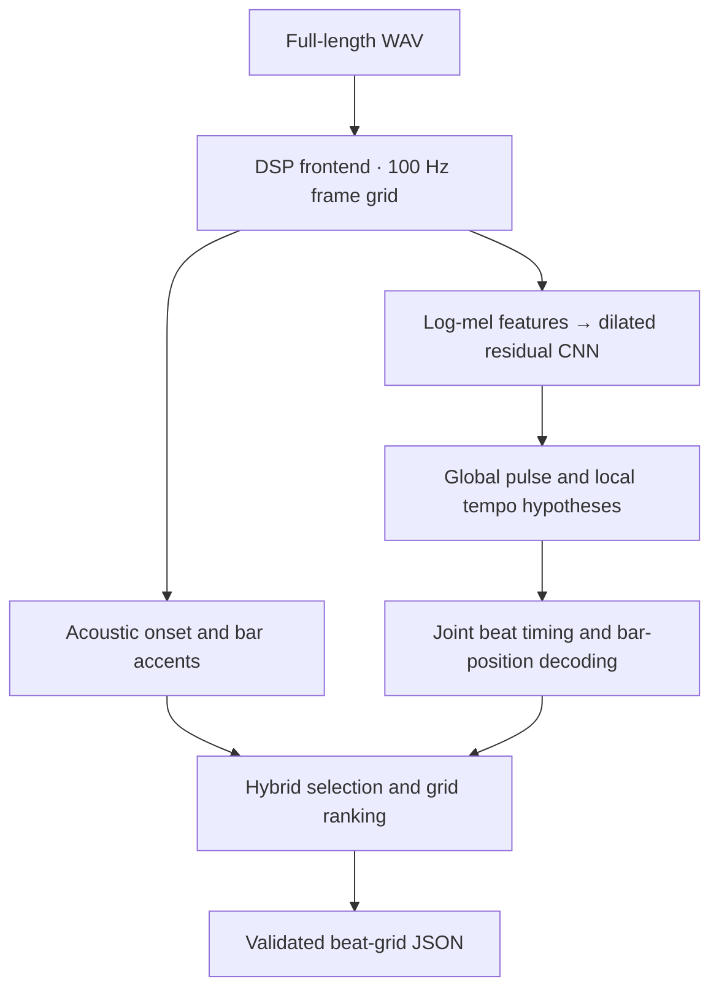
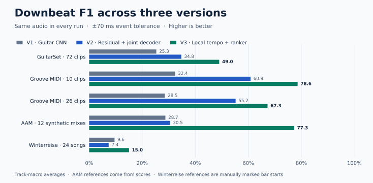
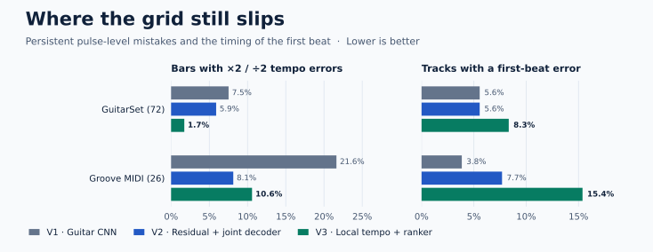
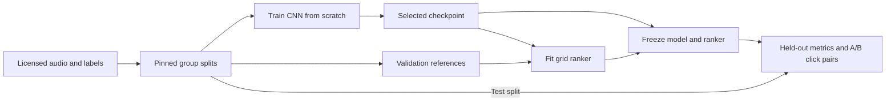

# Qildo Beat Grid

Offline **beat and downbeat tracking** for full-length music. A stereo WAV goes in. A timestamped, bar-numbered beat grid comes out for metronome playback, bar-aligned loops, and note synchronization. The project implements the public Qildo challenge #4 as an audio ML and music information retrieval (MIR) case study.

## 📈 Key achievements

- **Improved downbeat F1 across three model generations.** GuitarSet rose from **25.32% to 49.04%** and 26 additional held-out Groove MIDI recordings rose from **28.54% to 67.27%**.
- **Improved continuity through tempo changes.** On 24 ARTBeaT clips, beat F1 rose from **55.93% to 79.10%** and correct-metrical-level continuity (CMLt) rose from **26.65% to 58.60%**.
- **Trained the deployment candidate from random initialization.** The final run used **380 training recordings** across three data sources. The **112-track validation set** calibrated the sequence ranker.
- **Verified the offline CPU deployment.** Three four-minute stereo WAVs completed in at most **10.20 seconds** with **320 MiB peak RSS** in a network-disabled Linux ARM64 container on an Apple M4. The challenge allows 120 seconds per four-minute track.

[Quick start](#-quick-start) · [Architecture](#architecture) · [Experiments](#-experiments-and-results) · [Reproducibility](#reproducibility) · [License](#license)

## The engineering problem

A usable beat grid has to follow quiet introductions, maintain phase through syncopation, handle actual tempo changes, and distinguish the perceived pulse from its half-time and double-time alternatives. Detecting transients is only one part of the problem. For example, a hi-hat can provide strong evidence on eighth notes while the musician expects a click on each quarter note. A grid at the correct tempo can still start the loop one beat late.

| Contract | Behavior |
| --- | --- |
| Input | Full-length 44.1 kHz stereo WAV. Mono WAV and other sample rates are also accepted. |
| Output | JSON array of strictly increasing timestamps in seconds and one-based beat numbers. A `beat` value of `1` marks the start of a bar. |
| Meter | The default decoder allows three or four beats per bar and changes meter at bar boundaries. Use `--meters` to supply known beat counts. |
| Start of track | The output can start partway through a bar when the track has a pickup. |
| Runtime | Local file I/O and bundled model weights. The offline Docker run requires no network. |

## 🚀 Quick start

Run these commands from the repository root with Python 3.12 and a local file named `song.wav`.

```bash
python3.12 -m venv .venv
source .venv/bin/activate
python -m pip install -e '.[ml]'
python beats.py song.wav runs/song.beats.json
```

A pickup spanning beats 3 and 4 can produce this grid.

```json
[
  {"time": 0.512, "beat": 3},
  {"time": 1.012, "beat": 4},
  {"time": 1.512, "beat": 1}
]
```

The default ML run uses the bundled V3 checkpoint and ranker. Silence produces an empty array. Malformed WAV input exits with a nonzero status.

| Command options | Purpose |
| --- | --- |
| `--checkpoint checkpoints/quality.pt --ranker checkpoints/quality-ranker.json` | Pin the V3 model and scoring profile explicitly. |
| `--no-model` | Run the NumPy/SciPy acoustic tracker. This also works with the base install, `python -m pip install -e .`. |
| `--meters 4` | Restrict bar decoding to four beats when the meter is known. |
| `--checkpoint checkpoints/mixed-residual.pt` | Run the V2 hybrid baseline. |
| `--checkpoint checkpoints/guitarset-demo.pt --decoder sequence` | Run the V1 CNN baseline. |

### Offline Docker

```bash
docker build -t qildo-beats .
docker run --rm --network none \
  --mount "type=bind,source=$PWD,target=/io" \
  qildo-beats /io/song.wav /io/runs/song.beats.json
```

The default image bundles CPU PyTorch and its model assets. Use `--build-arg WITH_TORCH=0` for an acoustic-only image.

## Architecture



1. **Audio frontend.** SciPy performs polyphase resampling to 22 kHz. The frontend uses a short-time Fourier transform, 64 log-mel bands, spectral flux, and bass and chroma-change features at 10 ms resolution. Channel power is combined before feature extraction so antiphasic stereo content still contributes.
2. **Neural activation model.** A dilated temporal CNN combines short-range onsets with roughly five seconds of context on each side. Residual blocks fuse multiple temporal scales. The final head estimates beat probability and downbeat probability conditional on a beat. Inference processes the activations in overlapping windows and decodes the concatenated sequence as a whole track.
3. **Temporal decoding.** Global and local autocorrelation propose candidate pulse periods. A dynamic program follows plausible tempo trajectories and places beats between weak or missing attacks. A second dynamic program aligns beat timestamps to nearby evidence and assigns bar positions.
4. **Grid ranking.** A ridge-regression ranker combines neural support, acoustic onset coverage, downbeat contrast, interval stability, and boundary evidence. Calibration rewards F1 and continuity and penalizes sustained half-time and double-time errors. The ranker references the checkpoint by SHA-256 so a mismatched pair fails explicitly.
5. **Output contract.** The CLI validates timestamps and beat numbers before atomically writing JSON. A separate A/B renderer adds distinct clicks for beats and downbeats and randomizes the playback order.

### Tech stack

| Stack | Role |
| --- | --- |
| **Python · NumPy · SciPy** | Spectral features, autocorrelation, numerical optimization, dynamic programming, and WAV I/O |
| **PyTorch** | Training and inference for the dilated temporal CNN, weighted binary cross-entropy, and AdamW |
| **mir_eval** | Event matching, beat and downbeat F1, and continuity metrics |
| **mido · FFmpeg** | MIDI timing extraction and offline audio preparation for the training and evaluation corpora |
| **Docker · pytest · Ruff** | Network-disabled inference, regression tests, and static checks |
| **Matplotlib · Mermaid** | Benchmark graphics, architecture, and evaluation diagrams |

## 🧪 Experiments and results

### What changed between versions

| Version | Approach | Finding |
| --- | --- | --- |
| **V1** | GuitarSet CNN with sequence decoding. Also evaluated acoustic DSP and local peak picking as diagnostic baselines. | A guitar-trained activation model had limited transfer to drums. Local event scores left bar phase and global tempo decisions unresolved. |
| **V2** | Dilated residual CNN trained on guitar and drums, with joint beat and bar decoding. | Drum coverage and beat continuity improved. Errors on full mixes and unstable metrical levels remained visible in held-out tests. |
| **V3** | Hierarchical output, time-axis augmentation, full AAM mixes, local tempo paths, and a validation-trained ranker. | Aggregate quality improved across the measured domains. Some drum recordings still favored a half-time or double-time interpretation. |

On GuitarSet validation, local peak picking with the V1 CNN scored **47.38% beat F1** and **20.12% CMLt**. Sequence decoding with the same model reached **56.85%** and **44.10%**, showing that the activations benefited from temporal constraints. Later, selecting the best V2 grid with access to the reference revealed an observed ceiling of **73.18% beat F1**, compared with **64.06%** from heuristic selection. That gap motivated ranking candidate grids. The first ranker improved downbeat F1 and increased half-time and double-time errors, which led to an explicit penalty for sustained octave errors in calibration. [Experiment notes](docs/experiments-v3.md)

### Three-version benchmark



Each cell lists **V1 → V2 → V3** on identical files. F1 uses one-to-one matching within ±70 ms from the beginning of the recording. Scores are macro-averaged by track. A dash indicates the dataset lacks the reference annotation needed for the metric.

| Benchmark | Beat F1 (%) | Downbeat F1 (%) | CMLt (%) |
| --- | ---: | ---: | ---: |
| GuitarSet · 72 clips | 57.27 → 60.24 → **65.30** | 25.32 → 34.75 → **49.04** | 42.41 → 50.05 → **59.14** |
| Groove MIDI · 10 historical test recordings | 40.92 → 79.41 → **89.00** | 32.37 → 60.86 → **78.61** | 25.50 → 66.49 → **74.82** |
| Groove MIDI · 26 additional recordings | 69.58 → 73.40 → **82.86** | 28.54 → 55.22 → **67.27** | 54.34 → 61.22 → **72.48** |
| AAM · 12 complete synthetic mixes | 60.01 → 63.60 → **82.47** | 28.75 → 30.50 → **77.32** | 37.20 → 41.09 → **63.32** |
| ARTBeaT · 24 rhythmic stress tests | 55.93 → 61.86 → **79.10** | — | 26.65 → 38.04 → **58.60** |
| Winterreise · 24 voice and piano recordings | — | 9.57 → 7.36 → **15.03** | — |

### Failure analysis



Tempo error rates use stable reference bars as the denominator. First-beat error rates use tracks.

- **Bar phase improved most clearly on guitar.** On 240 bars whose beat times aligned in all three versions, sustained one-position downbeat shifts fell from **78 to 36 to 3**. First-beat errors rose from **4 to 4 to 6** out of 72 tracks.
- **The pulse level remains ambiguous on drums.** On the 26-recording slice, V3 improved all headline metrics. V2 had fewer stable bars with sustained half-time or double-time errors, **126 versus 164 out of 1,549**. First-beat errors increased from **2 to 4**.
- **The best configuration depends on the domain.** The acoustic tracker reached **82.96% downbeat F1** on score-rendered AAM mixes, compared with **77.32%** for V3. On live voice and piano in Winterreise, the acoustic tracker reached **18.59%**, compared with **15.03%** for V3. The cross-domain validation score determined the default configuration.
- **The offline deployment target is verified locally.** In a separate side-by-side run in the same container, worst elapsed time over three four-minute WAVs was **3.13 s, 2.69 s, and 3.62 s** for V1, V2, and V3. The headline 10.20 s figure is from the earlier V3 deployment check. Product-level acceptance depends on the closed Qildo evaluation and blind listening.

The evaluator also reports **AMLt**, which allows alternative metrical interpretations, first-beat accuracy, recall over the first eight beats, persistent phase shifts, and paired group-bootstrap comparisons. GuitarSet's test set covers three musical backing tracks. Both Groove MIDI test slices come from one held-out drummer. Winterreise covers one recording of the cycle. [V1 and V2 report](docs/results.md) · [V3 report and methodology](docs/experiments-v3.md)

## Reproducibility



The splits group related recordings by musical backing, drummer, or composition. The CNN checkpoint is selected by validation loss. The ranker is fitted on validation tracks and diagnosed with leave-one-group-out comparisons. Evaluation uses the frozen checkpoint and ranker.

| Corpus | Role and reference type | Source |
| --- | --- | --- |
| GuitarSet v1.1.0 | Training, validation, and guitar evaluation with beat-position annotations. | [Zenodo · CC BY 4.0](https://zenodo.org/records/3371780) |
| Groove MIDI v1.0.0 | Isolated live drums, with reference pulse and bar positions derived from MIDI timing. | [Magenta · CC BY 4.0](https://magenta.withgoogle.com/datasets/groove) |
| AAM v1.1.0 | Rendered full mixes with score-derived beat and bar references. | [Zenodo · CC BY 4.0](https://zenodo.org/records/5794629) |
| ARTBeaT | Pulse-only stress tests with tempo shifts, syncopation, and other rhythmic ambiguities. | [AudioLabs · CC BY 4.0](https://www.audiolabs-erlangen.com/resources/MIR/2024-ARTBeaT) |
| Winterreise, HU33 | Live voice and piano with manually annotated bar starts for external downbeat evaluation. | [Zenodo · dataset CC BY 3.0, HU33 recording marked public domain](https://zenodo.org/records/10839767) |

### Prepare data and train

Install the optional training, evaluation, and development dependencies. For GuitarSet, place `annotation.zip` and `audio_mono-mic.zip` in `data/downloads/`. Prepare the pinned Groove MIDI and AAM manifests using the commands in the [reproduction guide](docs/experiments-v3.md#воспроизведение).

```bash
python -m pip install -e '.[ml,eval,data,dev]'
python prepare_data.py data/downloads/annotation.zip data/downloads/audio_mono-mic.zip data/guitarset

python train.py data/guitarset/manifest.json runs/quality.pt \
  --additional-manifest data/groove/snapshot-c.json \
  --additional-manifest data/aam/manifest.json \
  --architecture hierarchical --augment --tempo-warp 0.12 \
  --channels 24 --batch-size 20 --epochs 14 --seed 2026

python -m scripts.fit_grid_ranker runs/quality.pt runs/quality-ranker.json \
  data/guitarset/manifest.json data/groove/snapshot-c.json data/aam/manifest.json \
  --include-acoustic
```

### Evaluate and listen

```bash
python evaluate.py manifest data/guitarset/manifest.json runs/guitar-v2.json \
  --split test --checkpoint checkpoints/mixed-residual.pt --save-predictions runs/guitar-v2

python evaluate.py manifest data/guitarset/manifest.json runs/guitar-v3.json \
  --split test --checkpoint checkpoints/quality.pt --ranker checkpoints/quality-ranker.json \
  --compare runs/guitar-v2 --save-predictions runs/guitar-v3

python -m pytest -q
ruff check .
```

For a blind comparison on one WAV, give listeners `A.wav` and `B.wav` and keep the answer key with the organizer.

```bash
python beats.py song.wav runs/song-v2.json --checkpoint checkpoints/mixed-residual.pt
python beats.py song.wav runs/song-v3.json
python render_clicks.py song.wav runs/song-v2.json runs/song-v3.json runs/listen --seed 7348
```

## Project structure

```text
.
├── beats.py                   # WAV-to-JSON inference CLI
├── train.py                   # Windowed PyTorch training and checkpoint selection
├── evaluate.py                # Track and manifest evaluation, paired comparisons
├── prepare_data.py            # GuitarSet annotations and grouped splits
├── prepare_groove.py          # Groove MIDI importer
├── render_clicks.py           # Randomized, metronome-overlay A/B renders
├── qildo_beats/
│   ├── audio.py               # Resampling, spectral features, acoustic evidence
│   ├── model.py               # CNN architectures and chunked inference
│   ├── decoder.py             # Pulse proposals and beat placement
│   ├── local_tempo.py         # Variable-tempo trajectories
│   ├── meter.py               # Joint timing and bar-position decoding
│   ├── selection.py           # Candidate grids and ranking features
│   ├── ranker.py              # Versioned, checkpoint-bound ridge scorer
│   └── metrics.py             # MIR metrics and failure diagnostics
├── scripts/                   # AAM importer, ranker fitting, external evaluations
├── benchmarks/                # Pinned split and track lists
├── checkpoints/               # Bundled model checkpoints and the V3 ranker
├── tests/                     # Decoder, I/O, training, and evaluation regressions
├── docs/                      # Russian technical reports and benchmark graphics
├── Dockerfile                 # Offline CPU inference image
└── pyproject.toml             # Packaging and dependency groups
```

[Russian architecture and annotation protocol](docs/task-04.md) · [Russian experiment report](docs/experiments-v3.md)

## License

[MIT License](LICENSE)

Copyright (c) 2019 Mohammad Eslamnia

Third-party audio and annotations retain their respective licenses listed in the [data provenance notes](docs/experiments-v3.md#протокол-и-данные).
